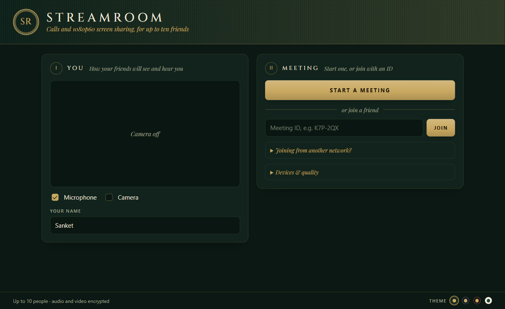
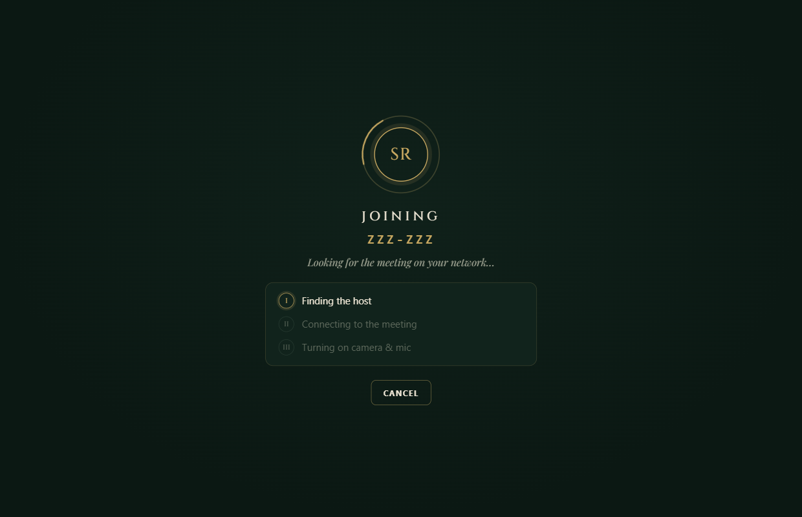
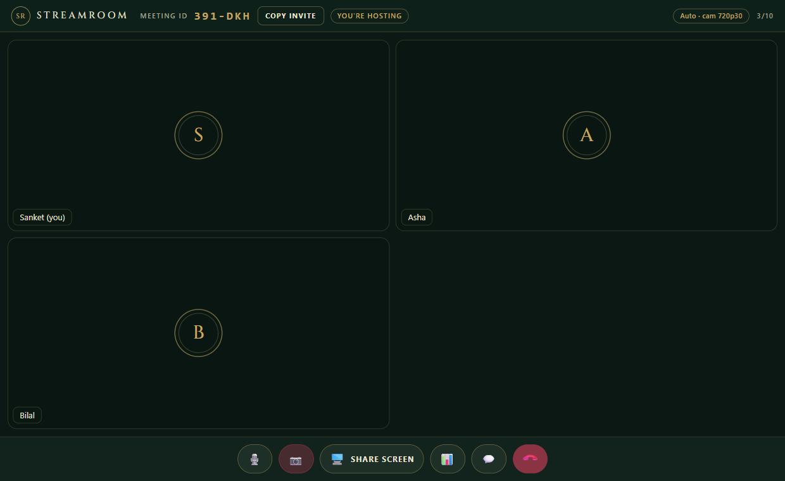
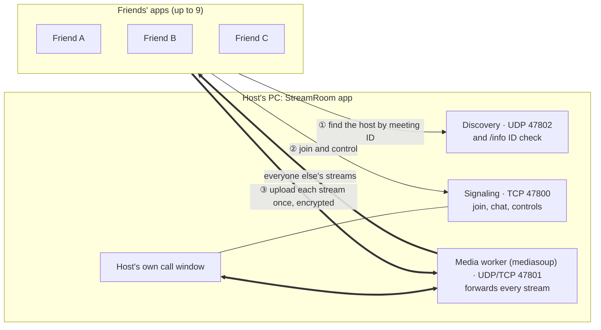
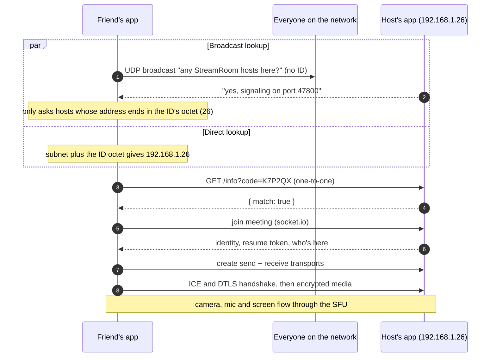
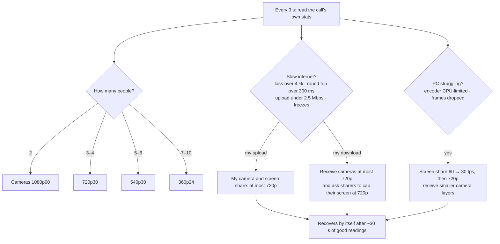
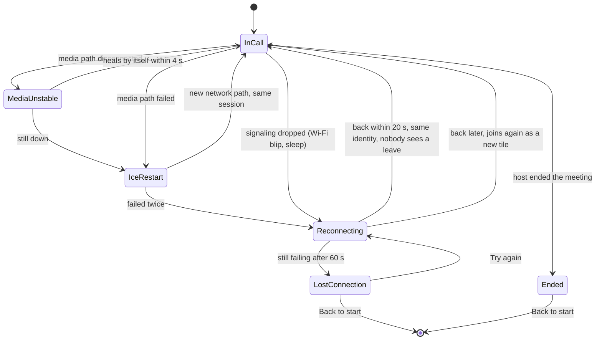

# StreamRoom

Group voice and video calls with **1080p 60 fps screen sharing** for up to **10 friends**, as a Windows desktop app.
No accounts, no website, no server to pay for: one person clicks **Start a meeting**, everyone else types a 6-character meeting ID.



## Contents

- [Features](#features)
- [Download and install](#download-and-install)
- [Using it](#using-it)
- [Friends on another network](#friends-on-another-network)
- [How it works](#how-it-works)
- [Automatic quality](#automatic-quality)
- [When the connection breaks](#when-the-connection-breaks)
- [Security](#security)
- [Building from source](#building-from-source)
- [Testing](#testing)
- [Troubleshooting](#troubleshooting)
- [Known limitations](#known-limitations)
- [Credits and license](#credits-and-license)

More detail lives in [docs/](docs): [architecture](docs/ARCHITECTURE.md), [connectivity options](docs/CONNECTIVITY.md), [security](docs/SECURITY.md), [testing](docs/TESTING.md).

## Features

- **Calls** with microphone and camera for up to 10 people.
- **Screen sharing** at 1080p60 (1440p60 optional), with computer sound, chosen from a picker of screens and windows.
- **Chat** with everyone in the meeting.
- **Spotlight** any tile with a click, or make it fullscreen.
- **Live stats** (📊): resolution, frame rate, bitrate and codec on every tile.
- **Automatic quality** that follows the group size, your network and your PC, and caps at 720p on slow internet.
- **Automatic recovery** from Wi-Fi blips, broken media paths and crashed apps.
- **Short meeting IDs** like `K7P-2QX`, forgiving about case, dashes and look-alike characters.
- **Four themes**: Heritage green, Midnight navy, Bordeaux and Ivory.
- **A quiet connecting screen** that shows progress and plays no sound until you're in the call.

| Connecting | In a call |
|---|---|
|  |  |

## Download and install

**Windows 10 or 11, 64-bit.**

1. Download `StreamRoom-win-x64.zip` from the [latest release](../../releases/latest).
2. Unzip it anywhere, for example `Documents\StreamRoom`.
3. Double-click **StreamRoom.exe**.

The first time you **host** a meeting, Windows Firewall asks whether StreamRoom may use the network. Tick **both Private and Public** and click **Allow**, or friends won't be able to reach you. This happens for `StreamRoom.exe` and for `mediasoup-worker.exe`, the part that carries audio and video. Joining a meeting doesn't need it.

Prefer an installer? `npm run dist` builds a one-click `StreamRoom-Setup-x.y.z.exe` that also adds those firewall rules for you (see [Building from source](#building-from-source)).

## Using it

**Hosting**
1. Type your name, then click **Start a meeting**.
2. You get a meeting ID such as `K7P-2QX`. Click **Copy invite** and send it to your friends.
3. Your copy of the app runs the meeting. When you leave, the meeting ends for everyone.

**Joining**
1. Type your name and the meeting ID, then click **Join**.
2. `k7p2qx`, `K7P-2QX` and `K7P 2QX` all work. `O` and `0` count as the same character, and so do `I`, `L` and `1`.

**In the call**

| Control | What it does |
|---|---|
| 🎙️ (or `M`) | Mute or unmute |
| 📷 (or `V`) | Camera on or off |
| **Share screen** | Pick a screen or window; tick *Share computer sound* to include audio |
| 📊 | Show resolution, fps, bitrate and codec on each tile |
| 💬 | Chat |
| 📞 | Leave (as host: end the meeting) |
| Click a tile | Spotlight it; click again to go back to the grid |
| ⛶ on a tile | Fullscreen |

**Devices & quality** on the start screen lets you pick the camera and microphone, cap the camera at 720p (data saver), and choose the screen-share mode: 1080p60 smooth (games, video), 1440p60 smooth, or 1080p30 sharp text (code, documents).

## Friends on another network

A meeting ID finds the host automatically when everyone is on the **same Wi-Fi or LAN**. For friends at other homes:

| Option | Cost | What to do |
|---|---|---|
| **Radmin VPN** | Free, no account | One person creates a network (name and password) and everyone joins it. Easiest for a group of Windows friends |
| **Tailscale** | Free personal plan | Works through any router, including mobile and carrier-shared internet. Share the host's device with friends |
| **Your own server** | Free (Oracle Cloud Always Free) | Run the browser version on a cloud machine; see [docs/CONNECTIVITY.md](docs/CONNECTIVITY.md) |

With a VPN, friends open **Joining from another network?** on the start screen and type the host's VPN address next to the ID. **Copy invite** includes that address automatically when the host is on a VPN.

[docs/CONNECTIVITY.md](docs/CONNECTIVITY.md) explains every option, what your router needs (IPv6, port forwarding, carrier-grade NAT), and why some setups can't be reached without a VPN or a server.

## How it works

Every person uploads each stream **once**; the host's app forwards it to everyone else. That design, a *Selective Forwarding Unit* (SFU) built on [mediasoup](https://mediasoup.org), is what makes 1080p60 practical for a group: in a direct "everyone sends to everyone" setup, each person would have to upload nine copies.



### Finding the host from a meeting ID

The ID is 30 bits written as 6 characters: 8 bits are the **last part of the host's local IP address** (for example the `26` in `192.168.1.26`) and 22 bits are random. The joining app races two lookups. **The ID itself is never broadcast**, and it's only sent to the address it points at, so nobody on the network can collect IDs.



More in [docs/ARCHITECTURE.md](docs/ARCHITECTURE.md): the signaling messages, ports, meeting ID format and code layout.

## Automatic quality

Quality adjusts on its own, every 3 seconds. It steps down after two bad readings in a row and back up after ten good ones (about 30 s), so it doesn't flicker. The badge in the top bar shows the current quality and, on hover, why it was lowered.



| Trigger | What happens |
|---|---|
| Group size | Cameras step down as the group grows. The screen-share bitrate is split across viewers (8 Mbps, down to 3.5 Mbps for 10 people) |
| **Slow internet** | **Everything caps at 720p.** Slow upload: your camera and screen share drop to 720p. Slow download: you receive at most 720p, and anyone sharing a screen caps it at 720p while you struggle |
| Busy PC | Screen share drops from 60 to 30 fps before it loses resolution; received cameras use smaller layers |
| Tile size | Small tiles get smaller camera layers; the spotlight gets full quality |

Cameras are sent in three sizes at once (simulcast), so each viewer gets the size that suits them. Screen shares are sent as one full-quality stream, because Chrome only uses the graphics card's H.264 encoder for single streams and software encoding can't hold 1080p60.

## When the connection breaks



| What goes wrong | What the app does |
|---|---|
| Wi-Fi blip, signaling drops | Reconnects automatically as the same person (resume token). Others see *reconnecting…* on the tile, not a leave and join |
| Media path breaks but signaling is fine (network switch, roaming) | ICE restart on the same session; after two failures, a full rejoin |
| A friend's app crashes or their laptop sleeps | Their tile shows *reconnecting…* and is removed after a 20 s grace period. Dead connections are noticed in about 10 s |
| A friend leaves on purpose | Removed immediately |
| The host's IP changes | The friend looks the host up again by ID while reconnecting |
| The host ends the meeting | Everyone sees *The meeting has ended*, with no pointless retries |
| The host's app crashes | Friends retry for 60 s, then see *Lost connection* with **Try again** |
| You go offline | *You are offline*; reconnects the moment the network is back |
| Camera or microphone unplugged | That stream stops cleanly with a notice; the rest of the call continues |
| No webcam at all | The microphone still works; the preview says *No camera found* |
| Wrong meeting ID | A clear error after about 6 s |
| Meeting full | *Meeting is full (max 10 people)* |

## Security

Built for friends on a home network or a private VPN. In short:

- **Audio and video are encrypted** (DTLS-SRTP, the standard for WebRTC).
- **Meeting IDs can't be looked up or collected:** the ID is never broadcast, and lookups only answer "yes, that's the meeting" for a correct ID.
- **Guessing is rate-limited:** 10 wrong joins a minute, 30 lookups a minute and 60 discovery queries a minute, per device. That makes guessing one of the 4 million IDs take years.
- **Only the app can connect** to a host, not a web page opened in a browser.
- **The host can't be flooded or knocked over:** limits on connections, streams, chat and message size, and garbled requests are rejected safely.
- **The app window is locked down:** no access to your system from the page, no navigation away, a strict content policy, and names and chat always shown as plain text.

**One caveat:** chat, names and meeting IDs travel **unencrypted** on your local network or VPN. That's fine at home with friends, but not on a network where someone may be sniffing traffic.

Full threat model, protections, review findings and fixes: [docs/SECURITY.md](docs/SECURITY.md).

## Building from source

Needs **Node.js 22+** and Windows 10/11 x64. `npm install` downloads Electron and mediasoup's prebuilt media worker.

```bash
git clone https://github.com/Sankey001/StreamRoom.git
cd StreamRoom
npm install
npm run app            # run the desktop app
```

| Command | What it does |
|---|---|
| `npm run app` | Build the page bundle and start the desktop app |
| `npm run dist:portable` | Build the app folder `dist/win-unpacked` (what the release zip contains) |
| `npm run dist` | Build the one-click installer `dist/StreamRoom-Setup-x.y.z.exe`, which also adds the firewall rules |
| `npm start` | Run the **browser version** instead (see below) |
| `npm test` | Unit and security tests |
| `npm run test:e2e` | End-to-end tests with real app copies |

### Browser version (optional)

`npm start` runs `server.js`, a web server version of the same meeting server, so people can join from Chrome or Edge without installing anything. It serves HTTPS on port 3000 (with a self-signed certificate unless you supply one) and plain HTTP on `localhost:3080` for the PC it runs on.

| Setting | Default | Meaning |
|---|---|---|
| `HTTPS_PORT` | `3000` | Web page and signaling |
| `LOCAL_HTTP_PORT` | `3080` | Plain HTTP, bound to `127.0.0.1` only |
| `RTC_PORT` | `44444` | All media, UDP and TCP |
| `ANNOUNCED_IP` | your LAN IP | Set to the public IP when hosting for people outside your network |
| `MAX_PEERS` | `10` | People per meeting |
| `MAX_ROOMS` | `5` | Meetings at once |
| `ROOM_PASSWORD` | none | **Set this before putting the server online.** Everyone types it on the start page |
| `TLS_CERT`, `TLS_KEY` | self-signed | Paths to a real certificate, for example from Let's Encrypt |

### Project layout

| Path | What |
|---|---|
| [app/main.js](app/main.js) | Desktop app: hosting, permissions, window, screen-picker bridge |
| [app/discovery.js](app/discovery.js) | Finding a host on the network from a meeting ID |
| [app/preload.cjs](app/preload.cjs) | The small bridge between the page and the app |
| [server/sfu.js](server/sfu.js) | Signaling and the mediasoup SFU, shared by the app and the browser version |
| [server/net.js](server/net.js) | Network adapter helpers |
| [server.js](server.js) | Browser version |
| [client/app.js](client/app.js) | Call UI, media, reconnect logic |
| [client/quality.js](client/quality.js) | Automatic quality |
| [client/code.js](client/code.js) | Meeting IDs |
| [public/](public) | Page, styles and bundled fonts |
| [build/installer.nsh](build/installer.nsh) | Installer firewall rules |
| [test/](test) | Unit, security and end-to-end tests |

## Testing

```bash
npm test           # 40 unit and security tests
npm run test:e2e   # 12 end-to-end scenarios with 3 real app copies on one PC
```

The **security tests** run each attack for real against a live server: guessing IDs, listening for broadcasts, a fake host trying to collect IDs, a web page connecting, forged reconnect tokens, flooding, oversized messages, garbled requests and script in names.

The **end-to-end tests** start a host and two friends with fake camera, mic and screen, then break things on purpose: Wi-Fi blips, media failures, crashed apps, the host leaving or crashing, a slow viewer and a wrong ID.

Close any meeting you're hosting before `npm test`, since it uses the app's real discovery ports. Details and the scenario list: [docs/TESTING.md](docs/TESTING.md).

## Troubleshooting

| Problem | Try this |
|---|---|
| *No meeting with this ID was found* | Check the ID and that you're on the same Wi-Fi as the host. Some routers isolate devices on guest Wi-Fi; use the main network. Across networks, use a VPN and type the host's address |
| Friends can find the meeting but get no video or sound | The host's firewall is blocking media. Allow `StreamRoom.exe` **and** `mediasoup-worker.exe` on Private and Public networks, or reinstall with the installer |
| *Media connection failed* | Something blocks UDP/TCP port 47801 between you and the host (firewall, VPN settings, guest-network isolation) |
| Quality badge says *Slow internet · max 720p* | Your network is struggling; it recovers by itself after about 30 s of good connection |
| Screen share isn't 60 fps | Open 📊. *limited: cpu* means your PC is the bottleneck, so try the *Auto (H.264)* codec. *limited: bandwidth* means your network is |
| No computer sound in screen share | Tick *Share computer sound* in the picker. Window-only shares can't include system sound |
| *Can't use your camera/mic* | Another app may be using the camera, or Windows privacy settings block it: *Settings → Privacy & security → Camera / Microphone* |

## Known limitations

- **Windows only** for the desktop app. The browser version works from Chrome or Edge on any OS.
- **The host's PC carries the meeting.** Their upload speed limits the call: sharing 1080p60 with 9 friends needs roughly 70 Mbps of upload.
- **Same network or VPN only** for the desktop app. Reaching friends across the internet directly needs IPv6 or port forwarding on the host's router, which StreamRoom doesn't set up yet ([docs/CONNECTIVITY.md](docs/CONNECTIVITY.md)).
- **Chat, names and IDs aren't encrypted** in transit (audio and video are).
- **Not yet tested** with real webcams or between separate PCs: the automated tests use Chromium's fake devices on one machine.
- **The installer isn't code-signed**, so Windows SmartScreen may warn on first run: *More info → Run anyway*.

## Credits and license

StreamRoom is released under the [MIT License](LICENSE).

It's built on [Electron](https://www.electronjs.org), [mediasoup](https://mediasoup.org) and [socket.io](https://socket.io). It ships the [Cinzel](https://fonts.google.com/specimen/Cinzel) and [Playfair Display](https://fonts.google.com/specimen/Playfair+Display) typefaces under the SIL Open Font License; their licence texts are in [public/fonts](public/fonts).
