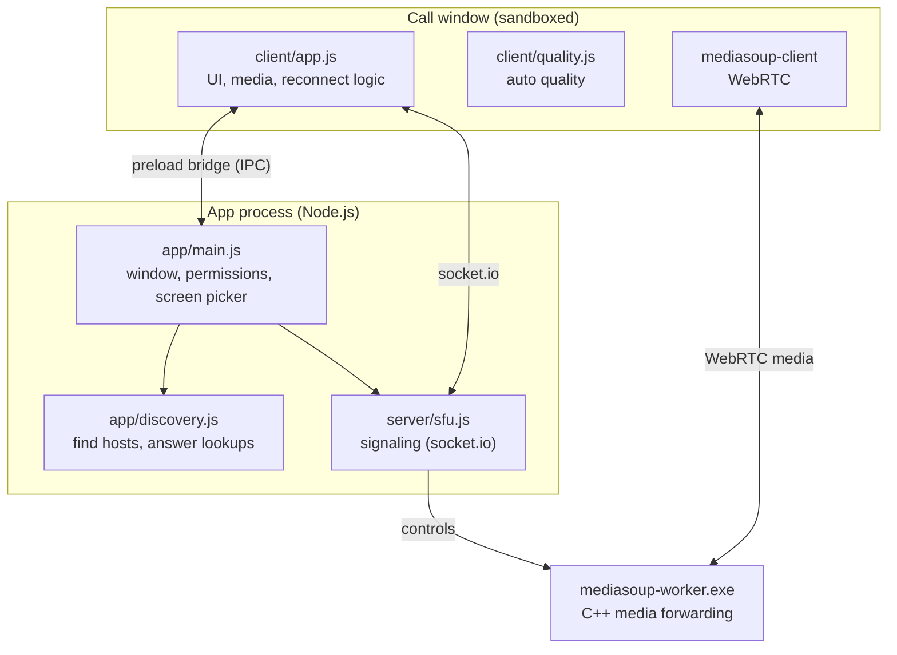
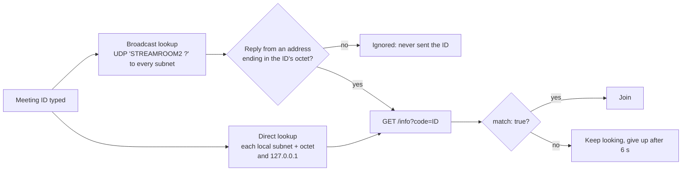

# Architecture

How StreamRoom is put together: the pieces, the ports, the meeting ID, and the messages between apps.

## The pieces



| Piece | Runs in | Job |
|---|---|---|
| [client/app.js](../client/app.js) | Call window | Start screen, call UI, camera/mic/screen, chat, reconnecting |
| [client/quality.js](../client/quality.js) | Call window | Reads WebRTC stats every 3 s and adjusts encoders and received layers |
| [client/code.js](../client/code.js) | Both | Meeting ID encode, decode and normalise |
| [app/preload.cjs](../app/preload.cjs) | Bridge | Exposes only: start/stop hosting, find a meeting, the screen picker |
| [app/main.js](../app/main.js) | App process | Window, permissions, hosting lifecycle, screen-picker handler |
| [app/discovery.js](../app/discovery.js) | App process | LAN lookup (broadcast and direct), `/info` endpoint, rate limiting |
| [server/sfu.js](../server/sfu.js) | App process (host only) | Signaling, rooms, peers, mediasoup transports, producers and consumers |
| `mediasoup-worker.exe` | Own process | Receives and forwards RTP; does bandwidth estimation and simulcast layer switching |
| [server.js](../server.js) | Node.js | The optional browser version: HTTPS + the same `sfu.js` |

Only the **host** runs the SFU. Every app, the host's included, joins as an ordinary participant over socket.io; the host's app simply connects to `127.0.0.1`.

## Ports

| Port | Protocol | Who listens | Used for |
|---|---|---|---|
| 47800 | TCP | Host | Signaling (socket.io over WebSocket) and `/info` |
| 47801 | UDP and TCP | Host (mediasoup worker) | All audio and video for every participant; TCP is the fallback |
| 47802 | UDP | Host | Discovery: answering "any StreamRoom hosts here?" |
| 3000 / 3080 / 44444 | TCP / TCP / UDP+TCP | Browser version only | HTTPS page and signaling / local HTTP / media |

Nothing listens unless someone is hosting. The host's media worker listens on every IPv4 adapter (Wi-Fi, Ethernet, VPNs such as Tailscale or Radmin), so whichever path a friend can reach works.

## Meeting ID

```
 30 bits  =  8 bits: last octet of the host's LAN IPv4   +   22 bits: random
 written as 6 Crockford base32 characters, shown as  K7P-2QX
```

- **Alphabet** `0123456789ABCDEFGHJKMNPQRSTVWXYZ`: no `I`, `L`, `O` or `U`. Typed `O` reads as `0`, `I`/`L` as `1`, `U` as `V`; case, spaces and dashes are ignored.
- **The octet** lets a joiner on the same subnet try `subnet.octet` directly, which works even when the router drops broadcasts.
- **The random part** (about 4.2 million values) is what keeps the meeting private. Guessing is rate-limited everywhere a guess can be made; see [SECURITY.md](SECURITY.md).

## Discovery



Both lookups race; the first host to confirm the ID wins. Joining over a VPN skips discovery: the friend types the host's address and the app asks that address directly (still with `/info?code=`).

## Signaling messages

All signaling is socket.io with acknowledgements. Every handler is wrapped so a bad request returns `{ error }` instead of throwing.

**Client → host**

| Message | Payload | Notes |
|---|---|---|
| `join` | `roomId, name, token?, password?` | Returns `peerId`, `token`, router capabilities, peers, slow viewers. A valid `token` resumes a dropped seat |
| `createTransport` | `direction: send \| recv` | Max one of each per person |
| `connectTransport` | `transportId, dtlsParameters` | |
| `restartIce` | `transportId` | Fresh ICE credentials after a network change |
| `ready` | `rtpCapabilities` | Host starts sending everyone else's streams |
| `produce` | `transportId, kind, rtpParameters, appData.source` | `source` is `mic`, `cam`, `screen` or `screen-audio`; one of each |
| `closeProducer` / `pauseProducer` / `resumeProducer` | `producerId` | Camera off / mute / unmute |
| `setConsumerLayers` | `consumerId, spatialLayer` | Ask for a smaller or larger camera layer |
| `netStatus` | `slow` | "My download is slow": screen sharers cap at 720p |
| `chat` | `text` | Max 1000 characters, 5 messages per 5 s |
| `leave` | | Leave now (no grace period) |

**Host → client**

| Message | Meaning |
|---|---|
| `peerJoined` / `peerLeft` | Someone arrived or left for good |
| `peerAway` / `peerBack` | Someone's connection dropped / they resumed within the grace period |
| `newConsumer` | Start receiving a stream (acknowledged, then resumed) |
| `consumerClosed` / `consumerPaused` / `consumerResumed` | That stream stopped, muted or unmuted |
| `activeSpeaker` | Who is talking (gold outline) |
| `slowViewers` | IDs of people with slow download |
| `chat` | A chat message |
| `meetingEnded` | The host closed the meeting on purpose: don't try to reconnect |

## Media

| Stream | Encoding |
|---|---|
| Camera | VP8, three simulcast layers (¼, ½ and full size), each with three temporal layers. Starts at the user's ceiling (1080p60 or 720p30); auto quality changes capture size, frame rate and bitrates |
| Screen | One layer, H.264 by default (VP9 or VP8 selectable), up to 8 Mbps at 1080p60 or 14 Mbps at 1440p60. `contentHint` motion or detail, degradation preference set to match. Highest priority at the SFU when bandwidth is short |
| Microphone | Opus mono with FEC and DTX; echo cancellation, noise suppression, auto gain |
| Screen sound | Opus stereo, 128 kbps, no voice processing. Windows system audio via Electron's loopback capture |

Local tracks outlive connections: after a reconnect the same camera, mic and screen tracks are published again, so nothing has to be re-picked.

## Reconnect rules

- **Signaling drop:** the server keeps the person's seat for 20 s (`peerAway`). The client retries with its resume token. If it's back in time, it keeps the same identity and others see `peerBack`.
- **Dead connections** are detected within about 10 s (socket.io ping every 5 s, 5 s timeout).
- **Media path:** `disconnected` for more than 4 s, or `failed`, triggers an ICE restart. Two failed restarts trigger a full rejoin.
- **Retry loop:** for 60 s, with growing pauses and an immediate retry when the network comes back. On the desktop app, every other attempt looks the host up again by ID in case its address changed.
- **Host ends the meeting:** the server sends `meetingEnded` before closing, so friends show the end screen instead of retrying.

## Security boundaries

The call window has no Node.js access (`contextIsolation`, `sandbox`), can't navigate away from its own page, and gets only camera, microphone and screen capture permissions. The host refuses websocket connections that come from a website (any `http`/`https` origin), and lets people in only with the meeting ID. Details: [SECURITY.md](SECURITY.md).
