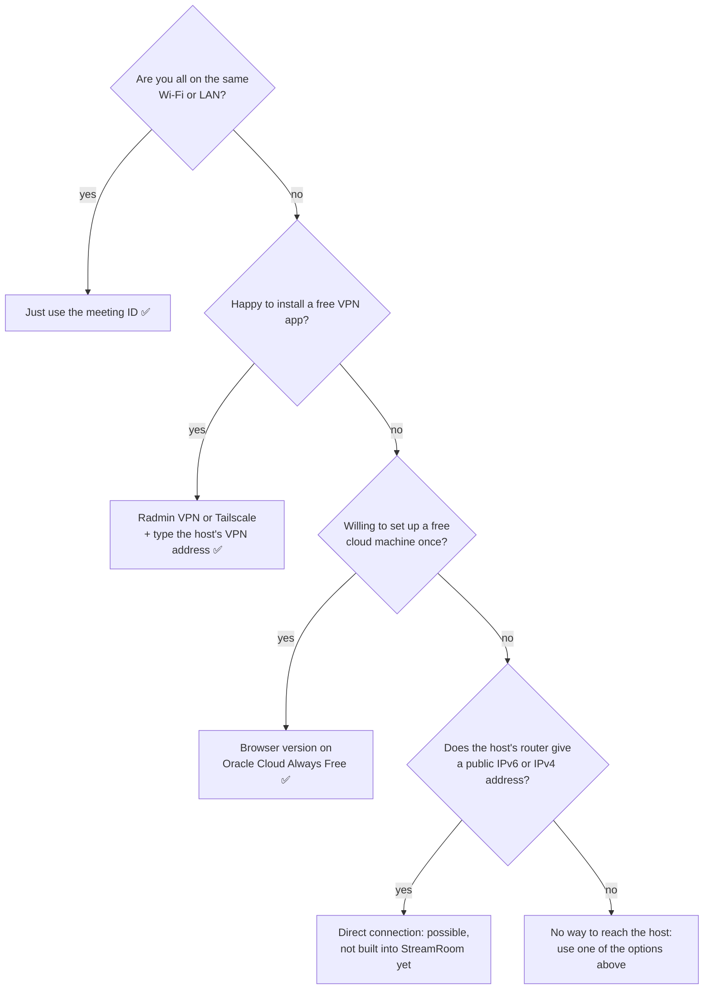

# Connecting friends

Which setups work, what each one needs, and why some can't work without help.

## Quick guide



## 1. Same Wi-Fi or LAN (built in)

Type the meeting ID. Nothing else to set up, apart from allowing StreamRoom through Windows Firewall the first time you host.

It won't work if:
- you're on a **guest network** or a network with **client isolation** (common in hotels, offices and some hostels), which stops devices from talking to each other;
- the host and the friend are on **different subnets** (for example wired `192.168.0.x` and Wi-Fi `192.168.1.x`) and the router doesn't pass broadcasts between them. Then type the host's local address under *Joining from another network?*

## 2. A free VPN (works today)

A VPN app puts everyone on one virtual LAN. StreamRoom listens on VPN adapters too, so it just works. Discovery by ID alone usually doesn't, because VPN addresses don't follow the ID's octet, so friends type the host's VPN address. **Copy invite** includes it automatically.

**Radmin VPN** (free, no account, Windows)
1. Everyone installs Radmin VPN from radmin-vpn.com.
2. The host clicks *Network → Create network*, picks a name and password, and shares them.
3. Friends click *Network → Join network*.
4. The host's Radmin address (starts with `26.`) is in the invite.

**Tailscale** (free personal plan; works through mobile and carrier-shared internet)
1. Everyone installs Tailscale and signs in.
2. The host shares their PC with friends (*Share…* in the admin console), or everyone joins one tailnet.
3. The host's Tailscale address (starts with `100.`) is in the invite.

## 3. Your own server, free (browser version)

Run `server.js` on an always-on cloud machine and everyone opens the page in Chrome or Edge. The desktop app can't connect to it yet. Because everyone connects *out* to the server, this works through any home router, carrier-grade NAT included, and the call's upload is the server's, not the host's.

1. Create an **Oracle Cloud "Always Free"** account. A card is needed for verification, but Always Free resources are not charged. Then create an Ampere (ARM) Ubuntu VM.
2. In the VM's *Security List*, allow inbound **TCP 3000** and **UDP + TCP 44444**. Open the same ports in the VM's own firewall (`iptables`/`ufw`).
3. Install Node.js 22, copy this repo, and run `npm install --omit=dev && npm run build`.
4. Get a free name at **duckdns.org** pointing to the VM, and a **Let's Encrypt** certificate (`certbot certonly --standalone -d yourname.duckdns.org`).
5. Start it:
   ```bash
   ANNOUNCED_IP=<the VM's public IP> \
   ROOM_PASSWORD='something long' \
   TLS_CERT=/etc/letsencrypt/live/yourname.duckdns.org/fullchain.pem \
   TLS_KEY=/etc/letsencrypt/live/yourname.duckdns.org/privkey.pem \
   HTTPS_PORT=3000 node server.js
   ```
6. Friends open `https://yourname.duckdns.org:3000`, type the password, then start or join a meeting.

**Always set `ROOM_PASSWORD` on a public server.** `MAX_ROOMS` (default 5) limits how many meetings can run at once.

Always Free includes 10 TB of outbound traffic a month. A 1080p60 screen share to 9 viewers is about 70 Mbps, roughly 30 GB an hour, so that's hundreds of hours of calls a month.

## 4. Direct over the internet (not built yet)

A host is reachable from the internet with no VPN and no server **only if their router lets it be**:

| What the host needs | How to check |
|---|---|
| **A public IPv6 address** (best: no port forwarding) | Windows: *Settings → Network → Properties*. An IPv6 address starting with `2` or `3` is public. Jio and Airtel fibre support IPv6, but it may be switched off in the router |
| **Or a public IPv4 address plus port forwarding** of TCP 47800 and UDP/TCP 47801 to the host PC | Router page (usually `http://192.168.1.1`): the *WAN / Internet IPv4* address must **not** start with `10.`, `100.64`–`100.127`, `172.16`–`172.31` or `192.168.`. Those mean your provider shares one address between many homes (carrier-grade NAT), so port forwarding can't work |

StreamRoom doesn't yet produce an internet invite for this. It would also need signaling encryption for the open internet. If neither IPv6 nor a public IPv4 address is available to anyone in the group, there is no way around it in software: two PCs that can't be reached from outside have no way to find each other. Use a VPN (option 2) or a server (option 3).

## Bandwidth

The host's app forwards every stream to everyone else, so **the host's upload** is the limit when friends are remote:

| Call | Host upload needed |
|---|---|
| 4 people, cameras only | about 6–8 Mbps |
| 4 people, 1080p60 screen share | about 25–30 Mbps |
| 10 people, 1080p60 screen share | about 70–80 Mbps |

Automatic quality lowers this as the group grows, and caps everything at 720p when someone's connection is slow. On a home LAN this doesn't matter: Wi-Fi and Ethernet have plenty.

## Windows Firewall

The host must allow **StreamRoom.exe** and **mediasoup-worker.exe** (the media part) on **Private and Public** networks. Windows often marks home Wi-Fi as "Public". The installer adds these rules; with the portable zip, Windows asks the first time you host.

StreamRoom only listens while you're hosting, and nobody can join without the meeting ID.
